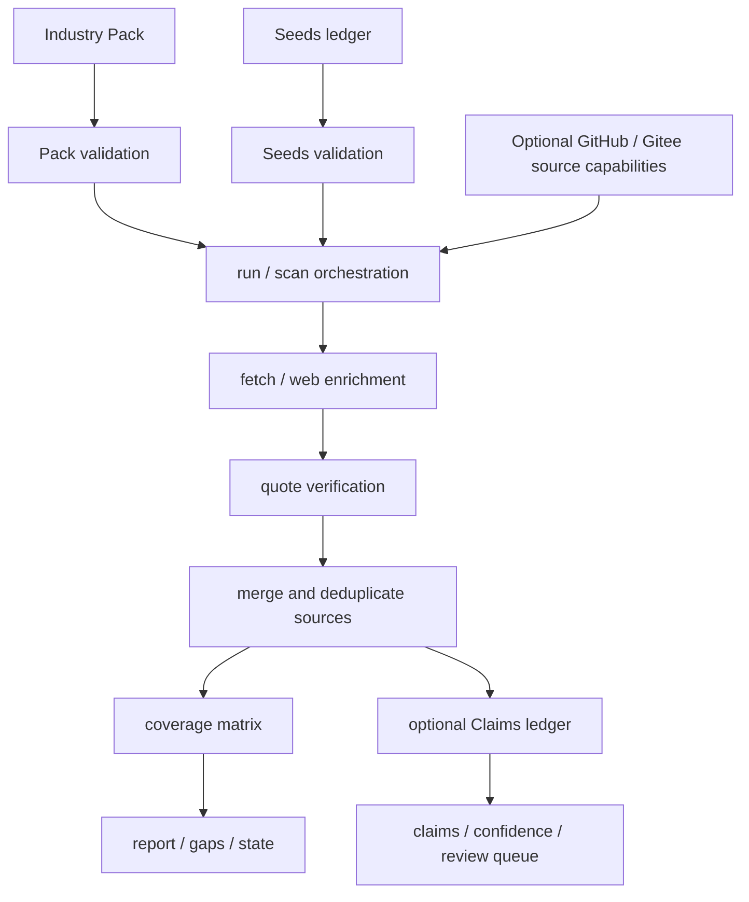
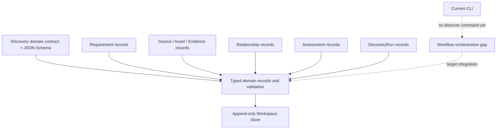
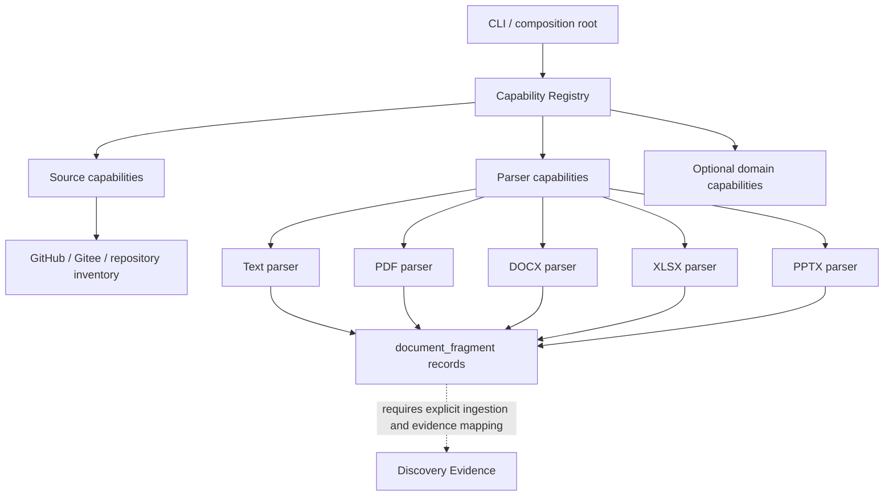
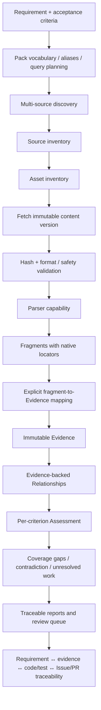

# Radar Architecture Overview and Consolidation Blueprint

> Document status: current-state architecture baseline + target-state blueprint  
> Baseline: `main@40c0528141b88c0a80ed25015b982ae44a8f8992`  
> Date: 2026-11-22  
> Authority: this document is the navigation and system-level architecture overview. Detailed object semantics remain owned by the linked contracts; this document must not silently redefine them.

## 1. Product boundary

Radar is an evidence-oriented discovery and assessment system. It should help a team answer:

1. What requirements and acceptance criteria are in scope?
2. Which sources and concrete assets may contain relevant information?
3. Which exact, versioned locations in those assets support or contradict a statement?
4. What remains unknown, unverified, incomplete or contradictory?
5. What can be concluded for each requirement criterion, and how can another person or model reproduce that conclusion?

Radar is not simply a repository search wrapper, a document converter, a crawler, an automatic PRD writer, or an LLM-generated answer store.

The durable product value is the traceable chain from requirement to source, asset, evidence, relationship and assessment. Search and parsers are replaceable capability providers; the domain contracts and provenance rules belong to Radar.

## 2. Current architecture at a glance

The current main contains a legacy executable path and a newer domain/storage foundation, plus parser and inventory capabilities. These pieces are related but are not yet one integrated discovery workflow.

### 2.1 Legacy Pack / Seeds evidence-coverage path

This path is implemented around `radar/model.py`, `radar/coverage.py`, `radar/claims.py`, `radar/cli.py`, and the legacy source adapters/capabilities. It remains useful for existing Packs, Seeds and historical run artifacts.

Its output is an evidence-coverage view over Pack units. It is not, by itself, the complete requirement-level assessment system.

### 2.2 Requirement-driven domain model and storage (not yet an end-to-end CLI workflow)

The new domain model and validators are implemented in `radar/discovery.py`; persistence primitives are implemented in `radar/discovery_store.py`; the JSON Schema is in `schemas/discovery.schema.json`. **The current `radar/cli.py` does not expose a `discover` command, and the current main does not yet connect these records into a complete Requirement → discovery → Evidence → Assessment workflow.** The canonical object semantics are specified in [DISCOVERY-DATA-MODEL.md](../DISCOVERY-DATA-MODEL.md).

Important semantic rules:

- Source identifies a source system or entry point; Asset identifies a concrete object within it.
- Evidence records a statement at a precise locator in a specific asset version.
- Relationship is a first-class, directional and auditable link.
- Assessment evaluates a versioned Requirement and its acceptance criteria; it does not rewrite Evidence.
- `mentions` is candidate relevance, not `supports` or `implements`.
- `no_evidence` is not equivalent to `not_implemented`.
- Evidence is immutable; changed source content creates a new versioned observation/evidence record.

### 2.3 Capability and parser path

The registry contract is documented in [CAPABILITY-REGISTRY.md](CAPABILITY-REGISTRY.md). It defines explicit registration and normalized result/failure semantics. It does not automatically discover arbitrary plugins or itself guarantee that every orchestration path is decoupled.

The parser contract and per-format contracts are documented under this directory. Parser output preserves parser-native locators but does not automatically become verified Evidence or an Assessment.

## 3. Core boundaries and ownership

| Boundary | Owns | Must not own |
|---|---|---|
| CLI / composition root | Parse arguments, assemble approved capabilities, invoke orchestration | Business truth, evidence promotion policy |
| Source capability | Source-specific discovery, retrieval metadata, candidate records, explicit partial/failure states | Requirement satisfaction decisions |
| Repository inventory | Enumerate candidate repository files at immutable commit/path/blob identity | File-content verification, parser execution, Evidence promotion |
| Parser capability | Extract fragments and native locators from supplied bytes/text | Source discovery, licensing decisions, requirement acceptance |
| Discovery domain | Workspace, Requirement, Source, Asset, Evidence, Relationship, Assessment, Run contracts | Provider-specific API payloads and parser internals |
| Workspace Store | Append-only persistence, stable lookup, content-addressed snapshots | Semantic inference or assessment |
| Legacy coverage/claims | Preserve legacy Pack/Seeds compatibility and historical reports | Replace the new Requirement/Evidence domain |
| Pack / industry knowledge | Domain vocabulary, module/subsystem structures, mappings and rules | Bind to a specific parser or runtime dependency |
| Assessment | Evaluate criteria from explicit evidence and rules | Turn search hits or model assertions into facts |

## 4. Data ownership and storage

There are currently two data families; they must not be conflated during cleanup.

### 4.1 Legacy run artifacts

Legacy `run` / `scan` artifacts include source ledgers, coverage matrices, reports, gaps, state and diffs. Legacy `claims` adds claim statements, confidence and a review queue.

These files must remain readable while the new discovery system evolves. Do not rename or reinterpret legacy fields as if they were already the new Source/Asset/Evidence objects.

### 4.2 Workspace discovery records

The new store persists typed JSONL collections for Requirements, Sources, Assets, Evidence, Relationships, Assessments and ledger-specific records, plus Workspace and Run metadata/snapshots.

Storage is append-oriented and validates records. Evidence immutability and requirement revision semantics are domain invariants, not optional conventions.

The physical store may evolve (for example, to a database) only behind the Storage contract. Any migration must preserve IDs, source versions, locators, record history and Workspace isolation.

## 5. Current capabilities and hard boundaries

| Capability | Current state on main | Explicit boundary |
|---|---|---|
| Legacy Pack / Seeds run, scan, diff, coverage and Claims | Implemented | Does not replace requirement-by-criterion assessment |
| GitHub / Gitee legacy repository metadata discovery | Implemented, opt-in | Metadata is not repository file content |
| Requirement-driven Discovery domain and Workspace storage | Domain records, validators, schema and JSONL storage primitives are present | No `discover` CLI command or end-to-end workflow orchestration in current main |
| GitHub code / Issue / PR discovery | Described in the Discovery data-model document's historical M6/M7 sections | Not established as an executable end-to-end capability in current main; the current legacy GitHub capability is repository metadata discovery |
| GitHub Repository Asset Inventory | Implemented as candidate inventory | No file body fetch, no parser invocation, no Evidence/Assessment promotion |
| Text / PDF / DOCX / XLSX / PPTX parser capabilities | Present in main with optional dependency workflows | Parser fragments are not Evidence; OCR, universal layout fidelity and all document edge cases are not implied |
| Capability Registry | Implemented | Explicit composition/registration remains required; not a general plugin marketplace |
| Business Graph / complete industry domain execution | Not established by the current main tree | Do not claim production-ready graph reasoning until persistence, query, provenance and assessment integration are tested |

## 6. Target end-to-end architecture

The intended full flow is:

The target flow is deliberately staged. A later stage must not silently be inferred from an earlier one:

- Search hit does not imply Asset content was fetched.
- Asset inventory does not imply content was validated.
- Parser success does not imply Evidence was promoted.
- Quote existence does not imply source authenticity or implementation.
- A code mention does not imply a requirement is implemented.
- A passing unit test does not imply a production workflow is correct.
- A model's interpretation does not become a fact without a cited Evidence basis.

## 7. Extension contracts

### 7.1 Add a source provider

1. Implement the Source capability contract with explicit inputs and typed result.
2. Normalize provider results into Source/Asset/Evidence records only where the source actually provides the necessary facts.
3. Preserve provider ID, immutable version, locator and retrieval timestamp.
4. Return `partial` for incomplete discovery and structured failures for unavailable/invalid results.
5. Add deterministic tests for pagination, duplicate identity, access failures, rate limits, partial results and credential redaction.
6. Do not promote candidates to verified Evidence by default.

### 7.2 Add a parser

1. Implement the Parser capability contract; accept content supplied by the caller.
2. Validate input type/size and isolate hostile formats.
3. Emit fragments with original content hash and parser-native locator.
4. Make optional dependencies lazy and isolate their installation.
5. Add positive, malformed, hostile, boundary and no-dependency tests.
6. Add an explicit ingestion mapping before fragments can become Evidence.

### 7.3 Add an industry knowledge pack

1. Keep it declarative and versioned.
2. Define canonical terms, aliases, language variants, module/subsystem IDs and acceptance mappings.
3. Separate industry-specific semantics from Core orchestration.
4. Provide representative positive, negative, ambiguous and contradictory examples.
5. Verify that changing Pack versions does not mutate historical Runs or Assessments.

## 8. Dependency and security architecture

The governing policy is [OPEN_SOURCE_COMPONENT_SELECTION.md](../OPEN_SOURCE_COMPONENT_SELECTION.md) and [dependency-management.md](dependency-management.md).

- Core remains lightweight and stable; zero-dependency is not an absolute product rule.
- Optional parser dependencies stay optional and lazily imported.
- No new runtime dependency enters Core without the documented evaluation and owner approval.
- Parser execution must not execute macros/scripts or arbitrary document code.
- XML parsing must retain the hardened XML safety boundary.
- Archive, file-size, recursion, path traversal and decompression limits must be explicit.
- Tokens must be passed through controlled runtime configuration, never written into Pack, Workspace, logs or generated artifacts.
- Partial, blocked, inaccessible and malformed results must not be converted to empty success.

## 9. Current architectural risks to resolve

| Risk | Why it matters | Required action |
|---|---|---|
| Two execution paths have overlapping vocabulary but different object semantics | Teams may treat legacy source/claim rows as new Source/Asset/Evidence records | Publish explicit mapping and migration boundary; keep compatibility adapters |
| Repository inventory is not connected to content ingestion | File candidates can be mistaken for evidence coverage | Implement fetch/hash/validate/parse/ingest stages with immutable provenance |
| Parser fragments are not Evidence | Parser success can be overstated as verified support | Add explicit fragment-to-Evidence promotion policy and tests |
| Issue/PR discovery does not yet prove complete engineering traceability | A PR description or diff is not the same as merged, tested and deployed behavior | Model PR, review, checks, merge commit and tests as separate assets/evidence/relationships |
| Registry is not proof of full decoupling | CLI may still compose concrete providers and orchestration may import implementation details | Audit imports and composition boundaries before moving modules |
| Documentation drift | README and component selection status do not match current architecture maturity | G4 must reconcile product summary, roadmap, component status and CI |
| Historical issue ledger is incomplete | Unknown findings can be lost or duplicated | G1 must recover R11–R92 from authoritative sources |

## 10. Canonical architecture documents

| Concern | Authoritative document |
|---|---|
| System-level architecture and current/target flows | This document |
| Discovery domain object semantics | [DISCOVERY-DATA-MODEL.md](../DISCOVERY-DATA-MODEL.md) |
| Capability interfaces and failure semantics | [CAPABILITY-REGISTRY.md](CAPABILITY-REGISTRY.md) |
| Parser contract | [DOCUMENT-PARSER-CAPABILITY.md](DOCUMENT-PARSER-CAPABILITY.md) |
| GitHub repository asset inventory boundary | [GITHUB-REPOSITORY-ASSET-INVENTORY.md](GITHUB-REPOSITORY-ASSET-INVENTORY.md) |
| Per-format parser behavior | PDF / DOCX / XLSX / PPTX capability documents in this directory |
| Dependency governance | [OPEN_SOURCE_COMPONENT_SELECTION.md](../OPEN_SOURCE_COMPONENT_SELECTION.md) |
| Legacy Pack / Seeds / Claims | README, PACK, SCHEMA, CLAIMS and migration docs until their G4 reconciliation |

If a detailed contract conflicts with this overview, the detailed object/API contract owns field-level semantics; this overview must be updated to match. If two detailed contracts conflict, record the conflict as a blocking architecture decision rather than choosing silently.

## 11. G2 exit criteria

- [x] Distinguish the legacy Pack/Seeds path from the new Requirement-driven Discovery path.
- [x] Define the Source → Asset → Evidence → Relationship → Assessment boundary.
- [x] Document Capability Registry and parser boundaries.
- [x] Separate current implemented behavior from target-state ingestion.
- [ ] Audit runtime imports and orchestration to verify actual decoupling.
- [ ] Verify all domain schema fields against runtime validators and persistence.
- [ ] Resolve owner decisions on identity, legacy locator, content-version references, ZIP limits and ledger ownership before the related PRs.
- [ ] Obtain owner review and merge approval.

G2 is a reviewable architecture baseline, not a declaration that the target end-to-end system is already implemented.
